  <picture>
    <source media="(prefers-color-scheme: dark)" srcset="public/brand/cognisync-horizontal-dark-transparent.svg" />
    
  </picture>

  Website and client app for <strong>Cognisync Solutions Limited</strong>: software development, database
  engineering, AI infrastructure, cloud &amp; DevOps, data engineering and systems integration.

---

## What we do: Digital Engineering

Cognisync designs, builds and runs the software, data platforms and AI infrastructure organizations depend on.
Our work is organized into seven disciplines, each with its own page on the site:

| Discipline | What it covers |
| --- | --- |
| **Software Development** | Custom web, mobile and enterprise applications designed around your workflows and built to scale with your business. |
| **Database Engineering** | Design, migration, tuning and administration for relational and NoSQL databases that stay fast, consistent and recoverable. |
| **AI Infrastructure** | The platforms, pipelines and compute that take AI from prototype to production: model serving, vector search and LLM integration. |
| **IoT & Embedded Systems** | Firmware, connected devices and sensor networks that bring data from the physical world into your systems, reliably and securely. |
| **Cloud & DevOps** | Cloud architecture, CI/CD pipelines, containers and infrastructure as code that make releases frequent, safe and repeatable. |
| **Data Engineering & Analytics** | Pipelines, warehouses and dashboards that turn scattered data into trustworthy reports and decisions. |
| **Systems Integration & APIs** | APIs and integrations that connect your systems, payment platforms and partners so data flows without manual re-entry. |

Some of the things we build:

- Customer portals, internal tools, ERPs and Android/iOS apps
- Database migrations, performance tuning, replication and tested backup and restore
- LLM-powered assistants and search grounded in a company's own documents (RAG)
- Microcontroller firmware, sensor networks and connected-device fleets with over-the-air updates
- CI/CD pipelines, Kubernetes platforms and infrastructure as code on AWS, Azure and Google Cloud
- Data warehouses, data pipelines and business dashboards
- M-Pesa, card and bank payment integrations, plus ERP and CRM connectors

Around every discipline sit the capabilities that make the work worthwhile: **Research & Development**,
**Product & UX Design**, **Innovation & Prototyping**, **Architecture & Consulting**, **Quality Engineering** and
**Knowledge Transfer & Training**.

Every engagement follows the same four phases: **Discover → Design → Build → Run**.

## Technologies we work with

Each discipline sits at the centre of its own stack.

<table>
<tr>
<td width="50%" align="center"></td>
<td width="50%" align="center"></td>
</tr>
<tr>
<td width="50%" align="center"></td>
<td width="50%" align="center"></td>
</tr>
<tr>
<td width="50%" align="center"></td>
<td width="50%" align="center"></td>
</tr>
<tr>
<td width="50%" align="center"></td>
<td width="50%" align="center"></td>
</tr>
</table>
