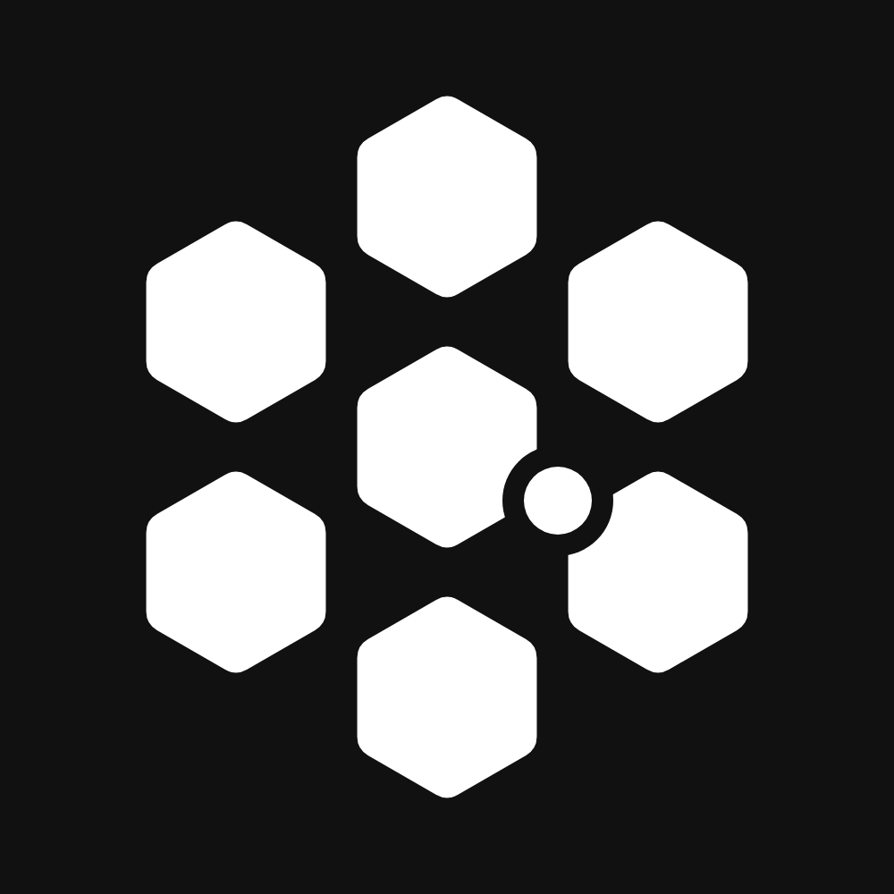
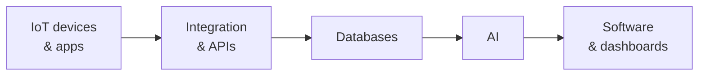

  

  <strong>Engineered for the Unimagined.</strong> 
  An AI-first engineering company based in Nairobi, Kenya.

---

## Company

Cognisync builds intelligent systems end to end: the models and data underneath, the software and integrations
around them, and the devices that connect them to the physical world. We take AI from idea to production and stay
to run, measure and improve it.

## Our Great Manifesto

To position Africa at the forefront of global technological innovation by engineering intelligent solutions that redefine what is possible.

**Mission.** To accelerate Africa's technological and economic advancement by engineering and deploying
purpose-built, intelligent and future-ready solutions that transform businesses, solve complex problems and create
lasting impact.

**Values**

- **Customer obsession:** we start with our clients' real problems and work backwards to the solution.
- **Ownership:** we take responsibility for outcomes, from the first line of code to long-term support.
- **Innovative:** we question defaults and engineer what does not exist yet.
- **Impact:** we measure success by the difference our work makes for our clients, their customers and the continent.

## What we do

**Software Engineering**

| Practice | Focus |
| --- | --- |
| **Software Design & Development** | Requirements, system and UX design, then web, mobile and enterprise applications built to scale. |
| **AI Infrastructure** | LLM integration, retrieval (RAG) and vector search, model serving, evaluation and monitoring. |
| **Database Engineering** | Data modelling, migrations, performance tuning, replication and tested backup and restore. |
| **Systems & API Integration** | APIs, payment platforms and ERP/CRM connectors that move data without manual re-entry. |
| **Cloud Management & DevOps** | Cloud architecture, CI/CD, containers and infrastructure as code on AWS, Azure and Google Cloud. |

**IoT & Embedded Systems**

| Practice | Focus |
| --- | --- |
| **Embedded Systems Design** | Hardware selection, circuit and PCB design, and prototypes built around microcontrollers and single-board computers. |
| **Firmware Development** | Reliable, low-power firmware for ESP32, Arduino and Raspberry Pi class devices. |
| **Connectivity & Sensor Networks** | Wi-Fi, cellular, LoRa and MQTT networks that link sensors and devices to the cloud. |
| **Device Management & OTA** | Provisioning, monitoring and over-the-air updates for connected-device fleets. |
| **Telemetry & Dashboards** | Real-time data pipelines, alerts and dashboards that feed real-world data into software and AI. |

## Software architecture

One connected system, from device to decision:

All of it runs on managed cloud infrastructure, deployed through CI/CD and monitored end to end.

## R&D and innovation

We research before we build, so clients invest in what works.

1. **Frame the question:** agree on what needs to be true for the idea to work, and what evidence would prove it.
2. **Investigate:** desk research, technical spikes and feasibility studies on the riskiest assumptions first.
3. **Prototype:** a working proof of concept, software or hardware, that people can try instead of imagine.
4. **Recommend:** findings, trade-offs and a practical roadmap, so the decision to build is an informed one.

Alongside client work we run innovation sprints, applied AI research and architecture consulting, turning
emerging technology into practical roadmaps.

## Core stack

## Contact

[cognisync.co.ke](https://www.cognisync.co.ke) · [info@cognisync.co.ke](mailto:info@cognisync.co.ke)
